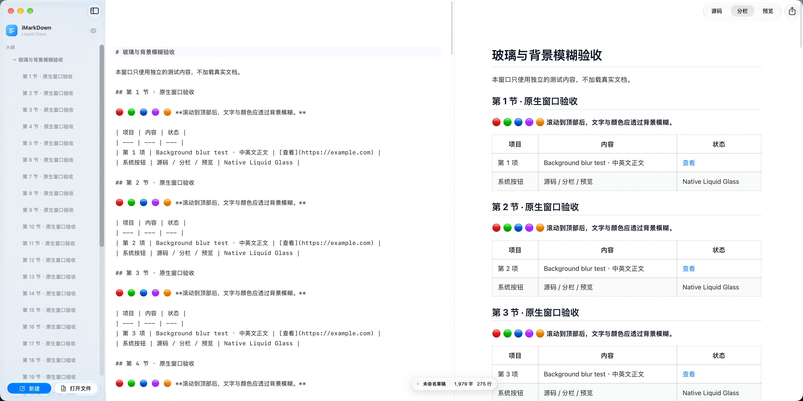

# iMarkDown

面向开发者的 macOS 26+ Markdown 文档工具，用于编写项目说明、技术方案与日常笔记。原生 SwiftUI 外壳与系统 Liquid Glass 组件，配合 WKWebView 承载的 CodeMirror、marked 与 highlight.js，兼顾熟悉的 macOS 交互与成熟的 Markdown 编辑、渲染能力。



- 分栏实时预览，源码 / 分栏 / 预览三种模式（⌘1 / ⌘2 / ⌘3）
- 原生文件导航：文件树与最近文件使用系统列表选择，支持键盘导航；按文件名搜索整个工作区及子目录
- 大纲导航：淡色标记当前阅读章节，支持折叠与点击跳转，独立于文件选中状态
- 预览中的任务清单可直接勾选，回写源码且支持撤销
- 自动恢复上次的编辑模式、侧栏状态与打开的文档
- 遵循系统设计语言：文件列表由系统绘制选中反馈，搜索与操作控件采用胶囊形状，内容容器保留普通圆角
- 官方 Liquid Glass：`glassEffect`、`GlassEffectContainer`、`NSGlassEffectView`（最低支持 macOS 26）
- 本地文件读写、最近文件、防抖自动保存、草稿恢复与未保存提醒；取消切换或打开失败后保留当前文档并恢复侧栏选择
- 浅色 / 深色 / 跟随系统，github / serif / compact 三套预览主题
- 导出 HTML / PDF（A4 自动分页），PDF 支持中文排版
- 全部前端依赖已 vendored 到仓库，离线可用，无需 Node

## 界面预览

**预览模式**：专注阅读正文，配合大纲定位章节。


**文件树搜索**：按文件名查找工作区中的 Markdown，搜索结果包含子目录文件。


## 环境要求

- macOS 26 及以上
- Swift 6 与 macOS 26 SDK（安装对应的 Command Line Tools 或 Xcode，无需 Xcode 工程）

## 构建与运行

```bash
./scripts/run.sh              # debug 构建并启动
./scripts/build-app.sh        # release 构建，产物 dist/iMarkDown.app
./scripts/build-app.sh debug  # debug 构建
```

构建脚本会自动寻找 Command Line Tools 中的 macOS 26 SDK，也可通过 `IMARKDOWN_SDK` 显式指定已安装的 SDK 路径：

```bash
IMARKDOWN_SDK=/Library/Developer/CommandLineTools/SDKs/MacOSX26.5.sdk ./scripts/build-app.sh release
```

首次构建若缺少 `Sources/iMarkDown/Resources/Web/vendor`，会自动执行 `scripts/fetch-vendor.sh` 下载依赖；正常编辑与渲染不需要联网。

核心检查可独立运行（SDK 路径按本机安装情况调整）：

```bash
swift run --sdk /Library/Developer/CommandLineTools/SDKs/MacOSX26.5.sdk MarkdownKitChecks
```

## 快捷键

| 操作 | 快捷键 |
| --- | --- |
| 新建 / 打开 / 保存 | ⌘N / ⌘O / ⌘S |
| 打开文件夹 | ⇧⌘O |
| 另存为 | ⇧⌘S |
| 源码 / 分栏 / 预览模式 | ⌘1 / ⌘2 / ⌘3 |
| 加粗 / 斜体 / 行内代码 | ⌘B / ⌘I / ⌘K |
| 插入链接 | ⇧⌘K |
| 查找 / 下一个 / 上一个 | ⌘F / ⌘G / ⇧⌘G |
| 文件列表键盘导航 | ↑ / ↓（焦点位于侧栏文件列表时） |

## 目录结构

```
Sources/
  MarkdownKit/            核心层：文档会话、文件读写、设置、最近文件、文件树、统计
  iMarkDown/
    App/                  应用入口、AppState 状态机、菜单命令
    Views/                RootView、侧栏、编辑工作区、状态 HUD、设置
    Design/               设计令牌、玻璃材质、胶囊操作控件与大纲阅读位置样式
    Editor/               WKWebView 容器、桥接协议、命令通道
    Services/             HTML 组装、PDF 导出、版本信息
    Resources/Web/        编辑器页面、样式、app.js 与 vendor 依赖
Support/                  Info.plist 等打包资源
scripts/                  构建、运行、依赖拉取脚本
docs/                     架构设计与 UI 规范
design/                   高保真可交互 UI 设计稿
```

## 文档

- [架构设计](docs/ARCHITECTURE.md)
- [UI 规范](docs/UI-SPEC.md)
- [UI 设计稿](design/ui-preview.html)（浏览器直接打开，支持明暗与模式切换）

## 项目定位

这是一个以自用需求驱动、面向开发者文档场景的开源项目，优先保持原生体验与每轮迭代可用。欢迎通过 Issue 反馈可复现的问题，或提交范围明确的改进。

## 许可

见 [LICENSE](LICENSE)。
