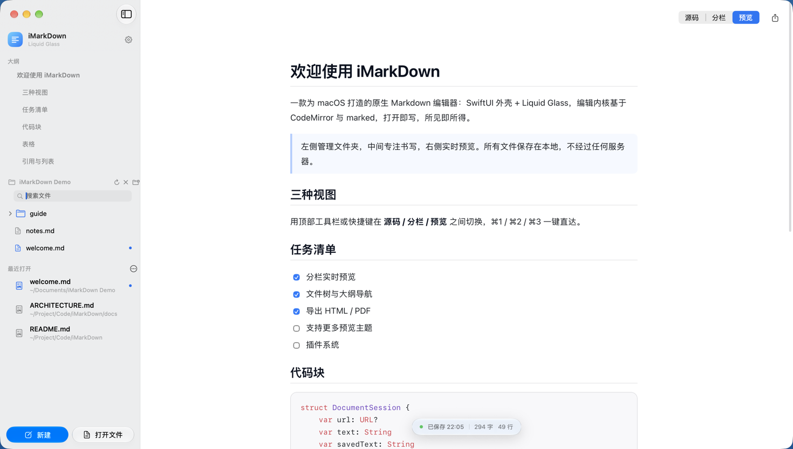
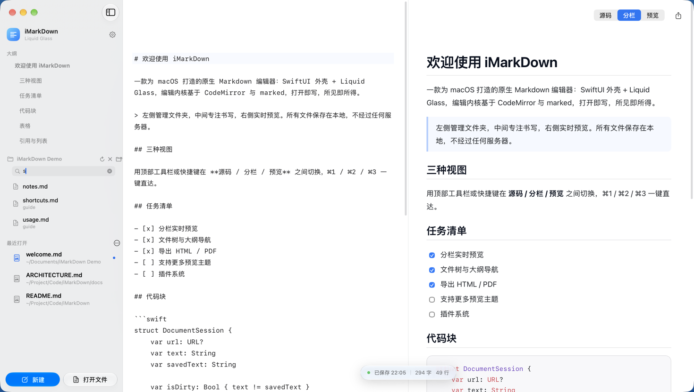

# iMarkDown

面向 macOS 26+ 的 Markdown 编辑器：原生 SwiftUI 外壳 + 官方 Liquid Glass 组件，内核使用 WKWebView 承载成熟的 Web 编辑器栈（CodeMirror + marked + highlight.js）。


- 分栏实时预览，源码 / 分栏 / 预览三种模式（⌘1 / ⌘2 / ⌘3）
- 左侧文件树：打开文件夹浏览 Markdown，按文件名搜索整个工作区
- 大纲导航：跟随滚动高亮当前章节，点击跳转
- 预览中的任务清单可直接勾选，回写源码且支持撤销
- 自动恢复上次的编辑模式、侧栏状态与打开的文档
- 官方 Liquid Glass：`glassEffect`、`GlassEffectContainer`、`NSGlassEffectView`（macOS 26+，低版本自动降级）
- 本地文件读写、最近文件、防抖自动保存、未保存提醒
- 浅色 / 深色 / 跟随系统，github / serif / compact 三套预览主题
- 导出 HTML / PDF（A4 自动分页），PDF 支持中文排版
- 全部前端依赖已 vendored 到仓库，离线可用，无需 Node

## 界面预览

**预览模式**



**文件树搜索**



## 环境要求

- macOS 26 及以上
- Swift 6（Command Line Tools 即可，无需 Xcode 工程）

## 构建与运行

```bash
./scripts/run.sh              # debug 构建并启动
./scripts/build-app.sh        # release 构建，产物 dist/iMarkDown.app
./scripts/build-app.sh debug  # debug 构建
```

首次构建若缺少 `Sources/iMarkDown/Resources/Web/vendor`，会自动执行 `scripts/fetch-vendor.sh` 下载依赖。

## 快捷键

| 操作 | 快捷键 |
| --- | --- |
| 新建 / 打开 / 保存 | ⌘N / ⌘O / ⌘S |
| 打开文件夹 | ⇧⌘O |
| 另存为 | ⇧⌘S |
| 源码 / 分栏 / 预览模式 | ⌘1 / ⌘2 / ⌘3 |
| 加粗 / 斜体 / 行内代码 | ⌘B / ⌘I / ⌘K |
| 插入链接 | ⇧⌘K |

## 目录结构

```
Sources/
  MarkdownKit/            核心层：文档会话、文件读写、设置、最近文件、文件树、统计
  iMarkDown/
    App/                  应用入口、AppState 状态机、菜单命令
    Views/                RootView、侧栏、编辑工作区、状态 HUD、设置
    Design/               设计令牌、GlassSurface、MeshGradient 背景
    Editor/               WKWebView 容器、桥接协议、命令通道
    Services/             HTML 组装、PDF 导出、版本信息
    Resources/Web/        编辑器页面、样式、app.js 与 vendor 依赖
Support/                  Info.plist 等打包资源
scripts/                  构建、运行、依赖拉取脚本
docs/                     架构设计与 UI 规范
design/                   高保真可交互 UI 设计稿
```

## 文档

- [架构设计](docs/ARCHITECTURE.md)
- [UI 规范](docs/UI-SPEC.md)
- [UI 设计稿](design/ui-preview.html)（浏览器直接打开，支持明暗与模式切换）

## 许可

见 [LICENSE](LICENSE)。
