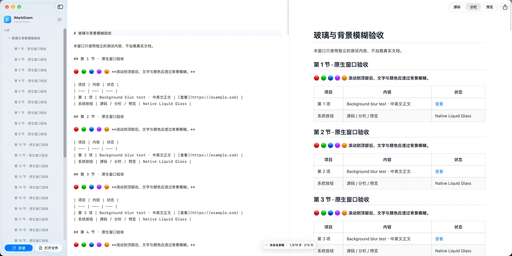

# iMarkDown 0.1.0 发布说明

**发布日期**：2026-11-23
**适用系统**：macOS 26.0 及以上
**安装包**：`iMarkDown-0.1.0-macos.dmg`

这是 iMarkDown 的首个公开版本：一个原生 SwiftUI 外壳 + Liquid Glass 界面的本地 Markdown 编辑器，编辑内核基于 CodeMirror + marked + highlight.js，所有前端资源已内置，离线可用。

## 功能亮点

- **三种视图**：源码 / 分栏 / 预览，快捷键 ⌘1 / ⌘2 / ⌘3 一键切换。
- **文件树**：打开整个文件夹作为工作区，支持新建、重命名、移到废纸篓、在 Finder 中显示；顶部搜索框按文件名过滤整个工作区，结果附带相对路径。
- **大纲导航**：侧栏实时解析标题，滚动时自动高亮当前章节，点击即可跳转。
- **任务清单交互**：预览中的复选框可直接点击，回写源码中的 `[ ]` / `[x]`，并支持 ⌘Z 撤销。
- **会话恢复**：自动记住编辑模式、侧栏状态和上次打开的文档，下次启动直接回到原处。
- **草稿保护**：未命名文档定时落盘，「最近打开」旁的草稿提示可在崩溃后恢复内容。
- **图片处理**：粘贴或拖入图片自动保存到文档同级 `assets` 目录，并插入相对路径。
- **查找替换**：支持区分大小写、正则表达式与全部匹配高亮。
- **导出**：HTML 与 PDF；PDF 按 A4 自动分页，中文排版正常。
- **外观**：浅色 / 深色 / 跟随系统，github / serif / compact 三套预览主题。

## 体验改进

- PDF 导出改为 `WKWebView.createPDF` + 块级分页合成，绕开 macOS 26 `printOperation` 无限分页的问题。
- 隐藏系统标题栏后，补回窗口拖动与双击标题栏缩放。
- Web 与原生桥接调用增加 3 秒超时，避免编辑器无响应时界面卡死。
- 大纲解析改为 220ms 去抖，输入长文档时不再每个按键都全量解析。
- 预览任务清单补齐 GitHub 样式类名，修正复选框与列表圆点并存的问题。
- 顶部悬浮控件根据正文是否进入覆盖区自动渐隐，正文滚动更干净。

## 已知限制

- 仅支持 macOS 26.0+，旧系统暂不可用。
- 首次打开「文稿」「桌面」等受保护目录时，需要按系统提示授权。
- 超过 600 KB 的文档会降级为纯文本预览，以保证输入流畅。
- 暂不支持文件夹重命名与文件树多选。

## 安装

1. 下载 `iMarkDown-0.1.0-macos.dmg`。
2. 将 iMarkDown 拖入「应用程序」。
3. 首次启动若提示「无法验证开发者」，在 Finder 中右键应用选择「打开」。

## 验证情况

- `swift run MarkdownKitChecks`：30 项检查全部通过。
- `./scripts/check-pdf.sh`：PDF 分页与 A4 尺寸回归通过。
- 已在真实界面验证文件树搜索、任务清单点击回写、⌘Z 撤销、窗口拖动与双击缩放、会话恢复。

## 界面

完整截图见 [README](../README.md#界面预览)。
